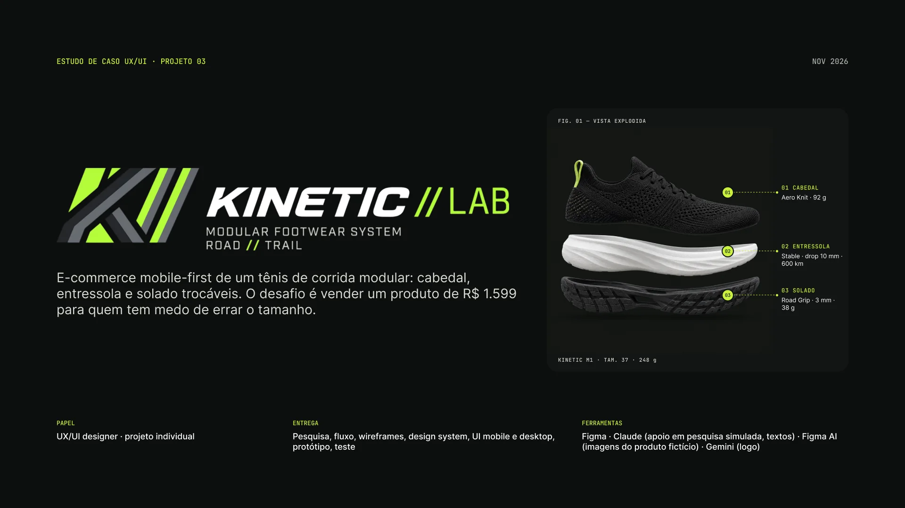

# KINETIC // LAB

Estudo de caso de UX/UI de um e-commerce mobile-first para um tênis de corrida modular, em que cabedal, entressola e solado são trocáveis. O desafio era vender um produto de R$ 1.599 para quem tem medo de errar o tamanho.



## Links

| | |
| --- | --- |
| Estudo de caso | https://portfoliozitomenezes.vercel.app/estudo-de-caso-kineticlab.html |
| Protótipo mobile | https://www.figma.com/proto/WHFA16vy2gCG04ZnnqaNjX/?node-id=35-18&starting-point-node-id=35%3A18&scaling=scale-down-width&content-scaling=fixed |
| Figma (processo completo, páginas 00 a 11) | https://www.figma.com/design/WHFA16vy2gCG04ZnnqaNjX |

## Sobre o projeto

Projeto 3 do portfólio, feito em 2 dias (15 e 16/11/2026) a partir de um brief fechado de curso. O MVP tem um questionário de ajuste em 5 passos que recomenda entressola, drop e tamanho, uma página de produto em que o preço muda na hora ao trocar cada módulo, frete por CEP antes do carrinho e um checkout em tela única com Pix, cartão e carteiras digitais. As telas foram desenhadas primeiro em 390 px e depois em 1440 px.

## Estrutura

```
.
├── docs/
│   ├── 00-escopo.md                  # MVP, V2, preços e a conta do custo por km
│   ├── 01-descoberta.md              # Matriz CSD, benchmarking, proto-personas e jornada
│   ├── 02-roteiro-teste.md           # Roteiro do teste de usabilidade (pronto, ainda não aplicado)
│   ├── 03-direcao-visual.md          # Referências e design system proposto
│   ├── 04-reavaliacao.md             # Revisão crítica antes do teste
│   ├── 05-avaliacoes.md              # Avaliação por 5 avaliadores simulados
│   ├── 06-aderencia-brief.md         # O brief item por item: o que foi atendido e o que mudou
│   ├── 07-plano-de-medicao.md        # Como medir as 4 metas do brief
│   ├── 08-avaliacao-simulada.md      # Percurso cognitivo com 5 perfis simulados
│   └── avaliacoes/                   # Avaliações individuais em HTML e PDF
└── logo/
    ├── *.png                         # Logo para fundo claro, fundo escuro e marca isolada
    └── original/                     # Imagem original gerada no Gemini
```

## Como ver

O repositório guarda a documentação do processo, sem código. Os documentos estão numerados na ordem das etapas, a partir do [00-escopo.md](docs/00-escopo.md). As telas e o protótipo estão no Figma.

## Ferramentas

Figma para wireframes, design system, telas e protótipo. Figma AI para as imagens do produto, Gemini para a primeira versão da logo e Claude para a pesquisa simulada, os textos e a montagem no Figma.

## Status

Etapas 00 a 09 prontas: brief, descoberta, definição, arquitetura, wireframes, design system, UI mobile, UI desktop e protótipo. A página 10 do Figma tem um percurso cognitivo com perfis simulados, e a página 11 mostra o que mudou no protótipo depois dele. O teste com pessoas reais ainda não foi feito; o roteiro está em [02-roteiro-teste.md](docs/02-roteiro-teste.md).

## Aviso

A marca é fictícia. Entrevistas, citações, personas e números foram simulados a partir do brief por causa do prazo, e isso está sinalizado em todo o material.

## Autor

Antonio Zito · [Portfólio](https://portfoliozitomenezes.vercel.app) · [LinkedIn](https://www.linkedin.com/in/antonio-zito-4b64b71b0) · [Behance](https://www.behance.net/antoniozitome)

© 2026 Antonio Zito. Textos, imagens e marca não podem ser reutilizados sem autorização.
